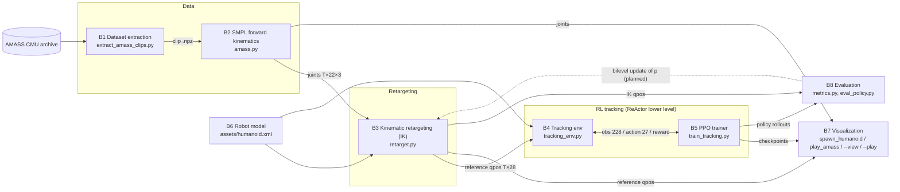
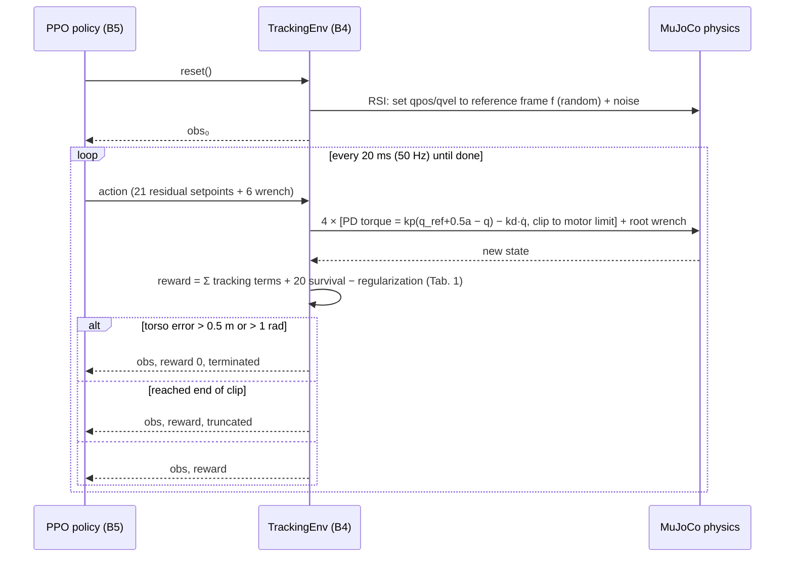
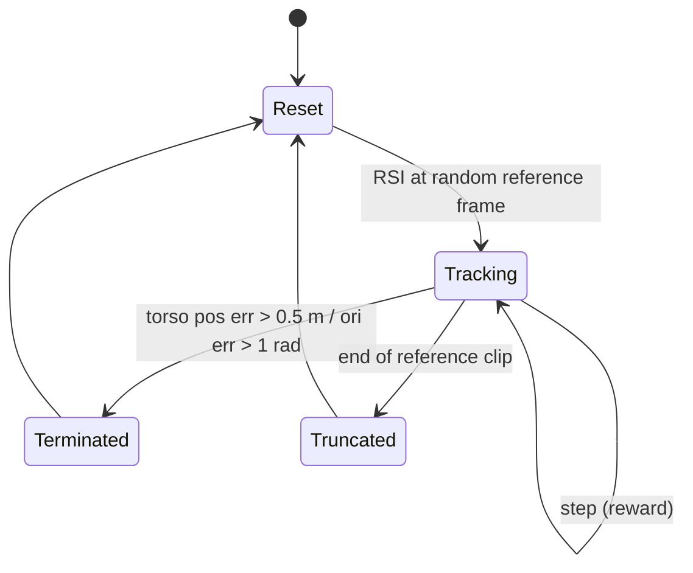

# Architecture

> Software view (scripts, data flow). For the **control / RL view** (loops, signals, rates, equations) see [control-architecture.md](control-architecture.md).

System model of the ReActor reimplementation. Diagrams are Mermaid (they render on GitHub). **Update this file whenever a block, interface or flow changes**; devlogs name the blocks they touch by ID (B1…B8).

## 1. Block diagram

| Block | Implemented in | Input | Output | Status |
|---|---|---|---|---|
| B1 Dataset extraction | `scripts/extract_amass_clips.py` | `dataset/CMU.tar.bz2` | `dataset/CMU/<subj>/<clip>.npz` | done |
| B2 SMPL forward kinematics | `scripts/amass.py` | clip `.npz` (+ optional `dataset/smpl/*/model.npz`) | joint positions (T, 22, 3), fps | done (approx. skeleton, ADR 0002) |
| B3 Kinematic retargeting | `scripts/retarget.py` | joints, robot model | `outputs/retarget/<clip>.npz` (qpos), `.png` | done |
| B4 Tracking env | `scripts/tracking_env.py` | reference qpos, robot model, action | obs, reward, done | done (ADR 0004) |
| B5 PPO trainer | `scripts/train_tracking.py` | B4 (8 parallel envs) | `outputs/tracking/<run>/model_*.zip`, `progress.csv` | done |
| B6 Robot model | `assets/humanoid.xml` | — | MJCF, 21 actuated hinges + free root | done |
| B7 Visualization | `spawn_humanoid.py`, `play_amass.py`, `retarget.py --view`, `train_tracking.py --play` | any of the above | viewer / PNG | done |
| B8 Evaluation | `metrics.py`, `eval_policy.py` | B3 qpos (+ source clip for contacts), B5 best policy | falls, body error, helper force; ground/self penetration, foot sliding, foot floating (IK vs RL) | done |

## 2. Interfaces (data contracts)

| Interface | File / object | Shape | Units / frame | Producer → consumer |
|---|---|---|---|---|
| AMASS clip | `dataset/CMU/.../*_poses.npz` | `poses` T×156, `trans` T×3, `betas` 16, `gender`, `mocap_framerate` | axis-angle rad; m; z-up; 120 fps | B1 → B2 |
| Source joints | `np.ndarray` | T×22×3 | m, world z-up, SMPL joint order (`amass.NAMES`) | B2 → B3, B7 |
| Keypoint map | `retarget.KP` | 17 entries (body, offset, SMPL ids, parent, weight) | m, body frame | B3 internal |
| Reference motion | `outputs/retarget/<clip>.npz` | `qpos` T×28, `fps` | root pos m + quat (w,x,y,z), 21 hinge angles rad; 120 fps | B3 → B4, B7 |
| Observation | `TrackingEnv._obs()` | 228 | m, rad, m/s, rad/s; heading frame for positions | B4 → B5 |
| Action | policy output | 27 = 21 joints + 6 wrench | [−1, 1] → ±0.5 rad residual setpoints; ±400 N, ±100 Nm (deadband 0.1) | B5 → B4 |
| Reward | `TrackingEnv._reward()` | scalar (+ `last_terms` dict) | weights of paper Tab. 1 | B4 → B5 |
| Checkpoint | `outputs/tracking/<clip>_<t0>-<t1>/model_<n>_steps.zip` + `model_vecnormalize_<n>_steps.pkl` | — | SB3 PPO + obs/reward normalization | B5 → B7 |

## 3. One RL episode (B4 ↔ B5)

