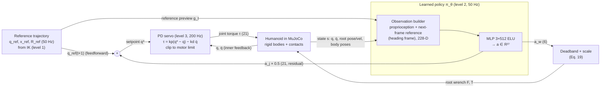
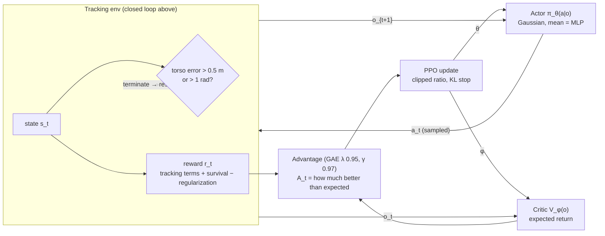

# Control & RL architecture

How the *controller* is built: which loops exist, what signals flow between them, at which rate, and where learning comes in. The software view (scripts, files) is in [architecture.md](architecture.md).

## 1. Big picture: a hierarchical tracking controller

| Level | Rate | What it is | Where |
|---|---|---|---|
| **(0) Retargeting optimizer** | per training round | Updates retargeting parameters p from tracking results (bilevel, paper Sec. 4–5) | *not implemented yet* |
| **(1) Motion planner** | offline | Kinematic retargeting (IK) gives a reference trajectory q_ref(t) for the robot | `retarget.py` |
| **(2) Learned tracking policy** | 50 Hz | Neural-network feedback controller: state + reference preview → joint setpoints + root wrench | `tracking_env.py` + PPO |
| **(3) Joint servo** | 200 Hz | PD controller per joint: setpoint → motor torque (saturated) | inside `env.step` |
| **Plant** | 200 Hz (MuJoCo, contacts) | Humanoid, 21 motors, free-floating root | `humanoid.xml` |

The structure is the classic **outer loop / inner loop** design: a slow, smart outer loop (the policy) chooses targets, and a fast, simple inner loop (PD) turns targets into torques. ReActor (Sec. 6) uses the same split.

## 2. Control block diagram (one control step)

Slide version (SVG/PNG): 

Two feedback loops close through the plant:
- **Inner loop (200 Hz):** the PD servo sees joint angle and velocity directly. It's fast and stiff, but it only knows "reach this angle"; it knows nothing about balance.
- **Outer loop (50 Hz):** the policy sees the whole-body state *and* where the reference is going next, and moves the setpoints so the robot stays balanced while following the motion.

## 3. Equations

| Signal | Equation | Notes |
|---|---|---|
| Joint setpoint | q*ⱼ = q_ref,ⱼ(t+1) + 0.5 · aⱼ | **Residual**: a = 0 means "just follow the reference" (paper: absolute setpoints) |
| PD torque | τⱼ = kpⱼ (q*ⱼ − qⱼ) − kdⱼ q̇ⱼ, kp = 4 · gear, kd = 0.1 kp | Run 4× per policy step |
| Saturation | τⱼ ← clip(τⱼ, ±gearⱼ) | Motor limit: 20–120 Nm depending on the joint |
| Root wrench | w = sign(a_w) · max(0, \|a_w\| − 0.1); F = 400 N · w₁:₃, T = 100 Nm · w₄:₆ | Residual force control, Eq. 18–19. Non-physical "helping hand", penalized |
| Plant | M(q) q̈ + C(q, q̇) = Sᵀτ + J_torsoᵀ [F; T] + J_cᵀ λ_contact | MuJoCo solves it, including contact forces λ |

## 4. Signals and rates

| Signal | Dim | Rate | From → To |
|---|---|---|---|
| Reference q_ref | 28 (7 root + 21 joints) | 50 Hz (resampled from 120 Hz) | IK → policy, setpoint sum |
| Reference body poses x_ref, R_ref | 16 bodies × (3 + 4) | 50 Hz | IK → observation, reward |
| Observation o | 228 | 50 Hz | plant + reference → policy |
| Action a | 27 = 21 joints + 6 wrench | 50 Hz | policy → servo / root |
| Joint torque τ | 21 | 200 Hz | PD → plant |
| Plant state | qpos 28, qvel 27 | 200 Hz | plant → PD, observation |

**What the policy observes:**
- **State feedback (proprioception, Eq. 20):** root height, gravity direction in the torso frame, root linear and angular velocity, 21 joint angles and velocities, the last 2 actions.
- **Feedforward / preview (the goal g_t):** the next reference frame's root height and tilt, its 21 joint angles, and all reference body positions relative to the robot in the heading frame. It also gets its own body positions, and the phase t/T.

In control terms the policy is a **nonlinear state-feedback controller with reference preview**. It's like a gain-scheduled tracking controller, except that the gains and schedule are learned instead of designed.

## 5. Why a policy at all: zero action as a baseline
With a = 0 the controller is **pure PD tracking of the IK reference** (feedforward only). In the env self-check it falls after 37 steps (0.74 s), because:
- the reference ignores dynamics, so it doesn't contain the ankle and hip strategies needed to keep the centre of mass over the feet;
- PD alone has no notion of balance or contacts.

The policy learns the **balance corrections on top of the feedforward reference**. That's the core idea of the lower level in ReActor.

## 6. Learning loop (training time only)

- **Actor-critic:** the actor is the controller. The critic only exists during training, to judge how good a state is.
- **Exploration:** at training time actions are sampled around the mean (std ≈ 0.37). At deployment and evaluation the mean is used (*deterministic*).
- **Reward = control objective:** tracking errors play the role of the cost in optimal control, torque and action-rate penalties are the effort cost, and survival plus early termination act as a constraint ("don't fall").
- **RSI:** episodes start at random reference frames, so every part of the motion gets practiced.

## 7. Mapping to the paper

| Part | ReActor (Sec. 6) | Here |
|---|---|---|
| Outer / inner loop | policy 50 Hz → PD | same |
| Setpoints | absolute | residual around reference ([ADR 0004](adr/0004-rl-tracking-simplifications.md)) |
| Residual root wrench | yes, Eq. 18–19 | same |
| Reward | Tab. 1, squared errors | same for now; exp kernels proposed ([ADR 0005](adr/0005-stabilize-rl-training.md)) |
| Level 0: bilevel retargeting update | yes, the main contribution | not yet |
